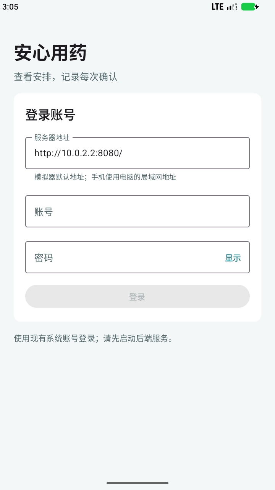

# 安心用药 · Android第一阶段

这是面向Android移动开发求职的独立练习工程，不计入HarmonyOS毕业设计交付。使用现有Spring Boot后端，只实现登录、查看今日任务、确认已服/跳过；不需要同时学习Java和Kotlin，先跟着调用链学习Kotlin。

## 从 GitHub 获取与运行

```powershell
git clone https://github.com/Ricardo23178/medication-android.git
cd medication-android
```

在 Android Studio 中打开克隆后的工程根目录，按提示安装工程需要的 Android SDK 37.1，并使用 JDK 25 运行 Gradle；应用字节码目标为 Java 17。由 IDE 生成本机的 `local.properties`，不要提交 SDK 路径。同步后选择 `app` 和设备运行，也可用 `./gradlew.bat assembleDebug` 构建。

下文的 `D:\Codex\MedicationAndroid`、`dev.ps1` 和 `studio.properties` 是作者本机的 D 盘运行配置；其他电脑按实际安装路径调整，不要求复制这些绝对路径。账号与任务由单独部署的 Spring Boot 后端提供，本仓库不包含后端或数据库。

## 界面预览

以下为模拟器截图，账号与任务均为虚构测试数据。

| 登录 | 今日任务 |
| --- | --- |
|  |  |

## 先运行

工程：`D:\Codex\MedicationAndroid`。Android Studio已安装在`D:\android-studio`，SDK在`D:\Android`。先关闭已运行的Android Studio，再用下面脚本打开，保证新进程继承D盘缓存与AVD目录：

```powershell
cd D:\Codex\MedicationAndroid
powershell -ExecutionPolicy Bypass -File .\dev.ps1 studio
```

在Studio的Gradle设置中确认Gradle user home为`D:\Codex\tools\gradle-home`，Gradle JDK为Studio自带JBR；不要从未配置环境的开始菜单直接进行首次Sync。脚本另外通过项目的`studio.properties`将IDE系统缓存和日志指向D盘，不改变原有IDE配置目录。此启动入口未自动打开IDE，需由你执行。

先在PowerShell构建并验证：

```powershell
cd D:\Codex\MedicationAndroid
powershell -ExecutionPolicy Bypass -File .\dev.ps1 check
```

脚本把Gradle缓存、Android用户目录和临时文件放到`D:\Codex\tools`，只更改本终端及子进程的环境。预备Gradle可用时直接复用，否则使用工程自带wrapper从官方地址下载并校验。首次构建需联网下载依赖；沿用本机既有项目的阿里云镜像，官方仓库备用。项目固定AGP9.3.1、Kotlin2.4.20、Gradle9.5.0，使用现有API37.1平台编译，最低Android8.0(API26)，target API36。

编译后的安装包：`app\build\outputs\apk\debug\app-debug.apk`。连接Android手机并开启USB调试，或启动Android模拟器后：

```powershell
powershell -ExecutionPolicy Bypass -File .\dev.ps1 devices
powershell -ExecutionPolicy Bypass -File .\dev.ps1 install
```

安装后打开“安心用药”。开发调试包允许HTTP，正式构建默认禁止明文HTTP；这里提供的是调试包，尚未配置发布签名。

## 连接现有后端

先按后端自己的README启动MySQL和Spring Boot。此工程不包含数据库口令，也不会自动建账号或计划。

- Android官方模拟器的地址填`http://10.0.2.2:8080/`，末尾斜杠可省略。10.0.2.2指向宿主电脑；不要填模拟器自己的127.0.0.1。
- 手机与电脑连接同一局域网，地址填`http://电脑IPv4地址:8080/`，并检查后端监听和Windows防火墙。不要将数据库端口对外开放。
- 输入现有系统中本人管理的账号密码。已有计划生成了任务才能在本页显示；没有任务会显示空态。
- 网络失败时核对后端进程、地址与端口；账号或密码错误会显示服务端提示。

服务端字段`scheduledAt/expireAt`没有时区，本端按原字符串表示的本地时间显示，今日范围及跨日未结束任务由后端决定。

## 五个阅读步骤

1. `data/Models.kt`：先看`data class`，认识请求、任务、Session；`val`表示只读引用，`String?`表示可能为空，`?:`用于空值兜底。
2. `data/MedicationRepository.kt`：理解接口只说明“能做什么”。`suspend`函数可等待网络，不把主线程堵住。
3. `data/HttpMedicationRepository.kt`：查看三条HTTP请求与JSON如何变成Kotlin对象；同时处理HTTP状态与响应体code。
4. `ui/MedicationViewModel.kt`：按`login → today → confirm`阅读。`StateFlow`保存当前页面状态，`viewModelScope.launch`启动可取消的协程。
5. `MainActivity.kt`与`ui/MedicationApp.kt`：找到`onLogin`等回调；页面读取状态，点击事件交给ViewModel，再由新状态更新页面。

代码位置均相对于`app/src/main/java/com/zhusixing/medication/`。

先掌握这一条链：**点击按钮 → ViewModel → Repository → REST接口 → 更新StateFlow → Compose刷新**。暂时不需要学习多模块、依赖注入框架或复杂设计模式。

## 三个入门练习

1. 只改登录页副标题，构建安装，确认界面变化，练习找到入口。
2. 在任务卡片上显示已有的`planVersion`，值为空时显示“未提供”，练习可空类型与条件显示；不要新增后端字段。
3. 阅读“重复点击只提交一次”的测试，断点观察`busyTaskId`如何变化，再解释为什么点击时要立即加锁。

先完成并能解释这三个练习，再进入药品/计划编辑等下一阶段。

## 当前行为边界

- 仅已有账号登录，不含注册、建计划、稍后操作、消息中心、后台通知、离线缓存。
- 会话保存在内存：旋转屏幕后由ViewModel保留，进程结束需要重新登录；密码不写入持久化文件。
- “已服/跳过”是用户确认记录，未确认不能说明真实漏服；另一端已处理的任务以服务端返回结果为准。
- 提交锁避免连点。网络结果不确定时保留原请求ID，手动重试同一操作；刷新核对仍待处理时保留原意图，退出登录可结束当前会话。
- 单元测试使用FakeRepository/MockWebServer；模拟器验收使用独立虚构数据，不触碰实际业务库。实际运行记录见`verification/RESULTS.md`，以该文件列出的验证范围为准。

## 参考的成熟方案

只参考官方示例中的Compose/ViewModel模式，未整套复制大型示例或引入其多模块结构。

- [Android架构建议](https://developer.android.com/topic/architecture/recommendations)
- [官方Compose示例Jetchat](https://github.com/android/compose-samples/tree/main/Jetchat)（Apache-2.0）
- [Retrofit官方项目](https://github.com/square/retrofit)（Apache-2.0）
- [模拟器网络地址说明](https://developer.android.com/studio/run/emulator-networking-address)
- [AGP9.3兼容性](https://developer.android.com/build/releases/agp-9-3-0-release-notes)
- [Kotlin Gradle兼容性](https://kotlinlang.org/docs/gradle-configure-project.html)

依赖使用Maven坐标管理；Gradle启动脚本及wrapper保留原始Apache-2.0版权声明。

备份配置参考：[Android官方备份规则](https://developer.android.com/identity/data/autobackup)。

## 本次交付与验证

已生成调试安装包，24项单测通过，模拟器完整流程和一次直接复验通过；Lint无错误，保留版本更新提示。详见[实际验收记录](verification/RESULTS.md)。本阶段没有进行真实后端账号或Android真机联调。

[登录页截图](verification/phase1-login.png) · [今日任务截图（虚构数据）](verification/phase1-tasks.png)

## Studio提示Gradle下载超时

本机已准备好Gradle9.5.0，命令行脚本直接复用它；Android Studio首次导入仍可能默认读取Wrapper下载地址。作者本机的`.idea/gradle.xml`已配置本地安装；`.idea`和原配置备份不上传仓库，克隆后的电脑需自行设置。Wrapper保持官方地址及校验值，便于其他机器使用。

如果Studio仍显示旧下载地址，按Ctrl+Alt+S，在设置中搜索Gradle：

- Distribution / Use Gradle from选择Specified location / Local installation。
- 安装路径填`D:\Codex\tools\gradle-9.5.0-local`，选包含bin和lib的根目录。
- Gradle user home确认`D:\Codex\tools\gradle-home`。
- 应用设置，再点击Sync Project with Gradle Files。

该设置参考[JetBrains官方Gradle设置](https://www.jetbrains.com/help/idea/gradle-settings.html)。IDE可能仍保留旧设置于内存，以上界面选项可直接确认并应用。没有修改应用业务代码。
