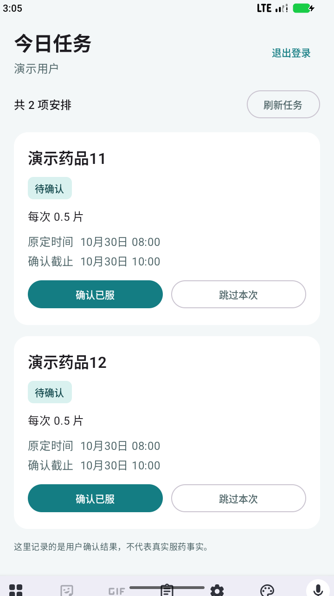

# 安心用药 · Android 客户端

用药提醒系统的 Android 端，Kotlin + Jetpack Compose + MVVM 实现，对接自研 Spring Boot 后端。与 [HarmonyOS 端](https://github.com/Ricardo23178/medication-harmony) 共用同一套 REST 接口，两端分别落地。

## 功能范围

登录 → 今日用药任务 → 确认已服 / 跳过本次。核心闭环内的三条主流程，不依赖本地假数据，全部走真实接口。

边界（有意未做）：注册、新建计划、消息中心、后台系统通知、离线缓存。账号与计划在 Web / 鸿蒙端维护，本端只负责当天的确认动作。

## 技术栈

| 层 | 选型 |
| --- | --- |
| 语言 | Kotlin |
| UI | Jetpack Compose + Material 3（Scaffold、LazyColumn、Card、TextField） |
| 状态 | ViewModel + StateFlow（内部持有 MutableStateFlow，对外暴露只读） |
| 网络 | Retrofit + OkHttp + Kotlin 协程 |
| 测试 | JUnit + FakeRepository + MockWebServer |
| 构建 | Gradle（AGP 9.3、Kotlin 2.4，minSdk 26、targetSdk 36） |

## 结构与数据流

```
app/src/main/java/com/zhusixing/medication/
├── MainActivity.kt                  # 入口，setContent 挂载 Compose
├── data/
│   ├── Models.kt                    # 请求 / 任务 / Session 数据类
│   ├── MedicationRepository.kt      # 接口定义（suspend 函数）
│   └── HttpMedicationRepository.kt  # Retrofit 实现，HTTP 状态与业务 code 双重判断
└── ui/
    ├── MedicationViewModel.kt       # 状态持有 + 三个动作 login / loadToday / confirm|skip
    └── MedicationApp.kt             # 页面读取 StateFlow，点击事件回调 ViewModel
```

单向数据流：**点击 → ViewModel → Repository → REST → 更新 StateFlow → Compose 重组**。视图层不直接发请求。

对接的三个接口：`POST api/auth/login`、`GET api/reminders/today`、`POST api/reminders/{id}/confirm`（确认与跳过共用，靠 `action` 区分）。

## 界面

模拟器截图，账号与任务为虚构测试数据。

| 登录 | 今日任务 |
| --- | --- |
|  |  |

## 几个实现细节

- **重复提交**：以 `busyTaskId` 标记在途任务，点击瞬间置位，同一条任务不会被重复确认；请求结束再复位。
- **生命周期**：请求在 `viewModelScope` 内启动，页面销毁随之取消，不会向已销毁的界面回写状态。
- **会话**：只存在内存，旋转屏幕由 ViewModel 保留，进程结束需重新登录；密码不落盘。
- **错误处理**：区分「HTTP 状态异常」与「响应体 code 异常」，分别提示，不吞异常。

## 运行

```bash
git clone https://github.com/Ricardo23178/medication-android.git
```

用 Android Studio 打开工程根目录，按提示安装对应 Android SDK 与 JDK，首次 Sync 会下载 Gradle 依赖。`local.properties` 由 IDE 生成，不要提交。

启动后端（[medication-backend](https://github.com/Ricardo23178/medication-backend)）后，在登录页填写地址：

- Android 官方模拟器：`http://10.0.2.2:8080/`（10.0.2.2 指向宿主机，不要填 127.0.0.1）
- 真机：手机与电脑同一局域网，填 `http://电脑IPv4:8080/`，并检查后端监听与防火墙

调试包允许明文 HTTP，正式构建默认禁止；本工程未配置发布签名。

## 测试

24 项单元测试通过，覆盖 ViewModel 状态流转、重复提交与网络响应解析；网络层用 MockWebServer，不依赖真实后端。构建与模拟器验收记录见 [verification/RESULTS.md](verification/RESULTS.md)。

## 参考

- [Android 架构建议](https://developer.android.com/topic/architecture/recommendations)
- [官方 Compose 示例 Jetchat](https://github.com/android/compose-samples/tree/main/Jetchat)（Apache-2.0）
- [Retrofit](https://github.com/square/retrofit)（Apache-2.0）
- [模拟器网络地址说明](https://developer.android.com/studio/run/emulator-networking-address)
